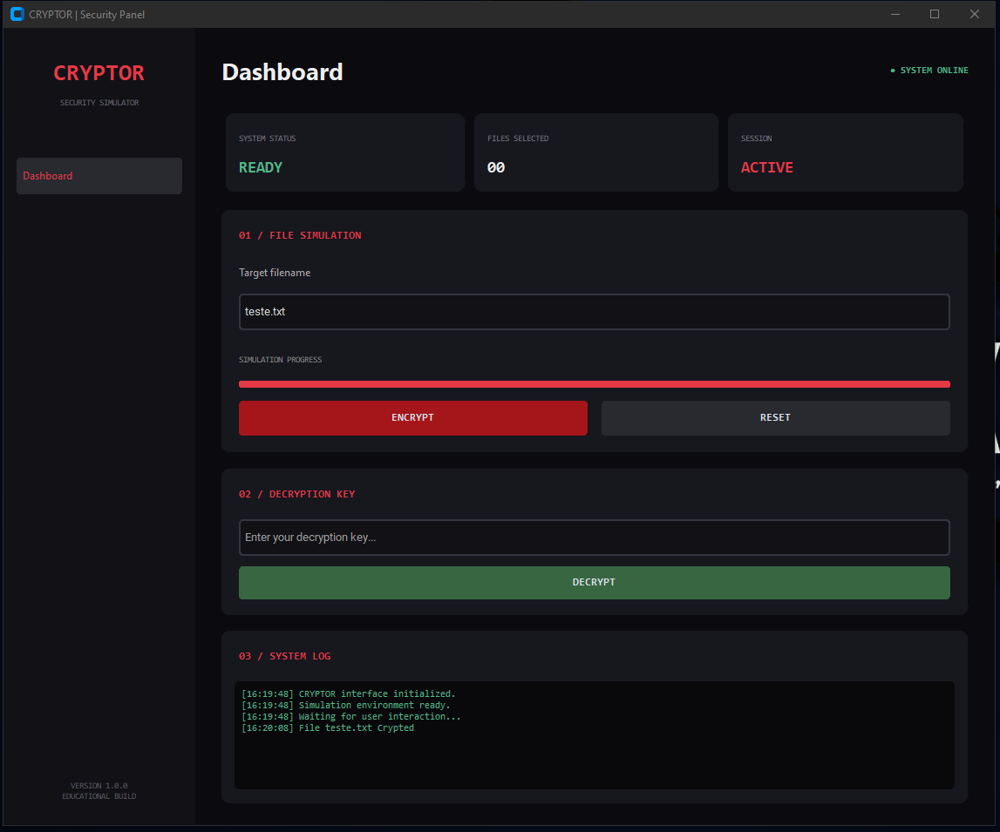
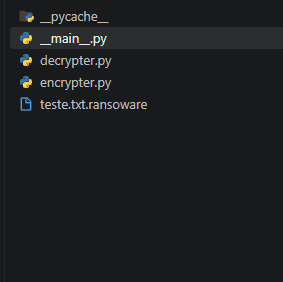

# CRYPTOR --- Educational Security Simulator

> **Projeto educacional:** desenvolvido para praticar programação em
> Python, interfaces gráficas e conceitos de criptografia e segurança da
> informação.

O **CRYPTOR** é um projeto de estudo com uma interface gráfica inspirada
em painéis de simulação de ransomware. Seu objetivo é explorar conceitos
de programação e segurança em um ambiente controlado, como parte do
aprendizado de Python.

O projeto não deve ser utilizado contra arquivos, sistemas ou
dispositivos de terceiros. Execute testes somente em um ambiente próprio
e autorizado.

------------------------------------------------------------------------

## 🖥️ Interface do programa

A imagem abaixo apresenta o programa e sua interface gráfica principal:



## 🔐 Exemplo de arquivo criptografado

A imagem abaixo mostra um exemplo de arquivo gerado pelo projeto após o
processo de criptografia:



------------------------------------------------------------------------

## 🧱 Arquitetura do projeto

A estrutura principal é organizada em três arquivos Python:

``` text
CRYPTOR/
│
├── main.py
├── encrypter.py
├── decrypter.py
│
├── images/
│   ├── program.png
│   └── crypter.png
│
└── README.md
```

### `main.py`

Responsável pelo ponto de entrada da aplicação e pela interface gráfica.
É nele que ficam organizados os componentes visuais, campos de entrada,
botões, indicadores de progresso e mensagens de status.

### `encrypter.py`

Módulo responsável pela parte de criptografia do projeto. Mantém essa
lógica separada da interface, facilitando a organização e a manutenção
do código.

### `decrypter.py`

Módulo responsável pela parte de descriptografia. Sua separação permite
estudar o fluxo inverso da criptografia e a organização de
responsabilidades entre módulos.

------------------------------------------------------------------------

## ⚙️ Tecnologias

-   **Python** --- linguagem utilizada no desenvolvimento.
-   **CustomTkinter** --- criação da interface gráfica.
-   **Criptografia** --- estudo de conceitos de proteção e recuperação
    de dados.

------------------------------------------------------------------------

## 🚀 Como clonar o projeto

1.  Clone este repositório:

    ``` bash
    git clone https://github.com/max1337xyz/SimpleRansoware
    ```

2.  Entre na pasta do projeto:

    ``` bash
    cd https://github.com/max1337xyz/SimpleRansoware
    ```

3.  Instale as dependências utilizadas pelo projeto. Por exemplo, para a
    interface:

    ``` bash
    pip install customtkinter
    ```

    Instale também outras dependências exigidas pelos módulos
    `encrypter.py` e `decrypter.py`, caso existam.

4.  Execute a aplicação:

    ``` bash
    python main.py
    ```

> `https://github.com/max1337xyz/SimpleRansoware`

------------------------------------------------------------------------

## 🎯 Objetivos educacionais

Este projeto foi criado para praticar e aprofundar conhecimentos em:

-   Desenvolvimento de aplicações com Python.
-   Construção de interfaces gráficas com CustomTkinter.
-   Organização de projetos em módulos.
-   Separação de responsabilidades entre interface e lógica.
-   Estudo de conceitos de criptografia e descriptografia.
-   Noções gerais de segurança da informação e hacking ético.

## ⚠️ Aviso de uso responsável

Este repositório tem finalidade exclusivamente educacional. O tema de
ransomware é utilizado como referência para estudar conceitos de
segurança e programação. Não utilize o projeto para acessar, alterar ou
criptografar dados sem autorização. Faça experimentos somente com dados
de teste e em ambientes controlados.

------------------------------------------------------------------------

## 📌 Status

Projeto desenvolvido para fins de aprendizado e experimentação. A
estrutura e as funcionalidades podem ser modificadas conforme a evolução
dos estudos.
